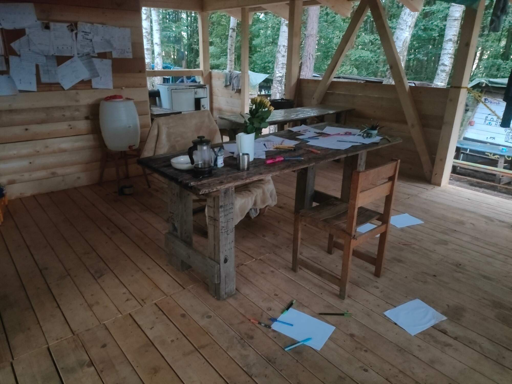
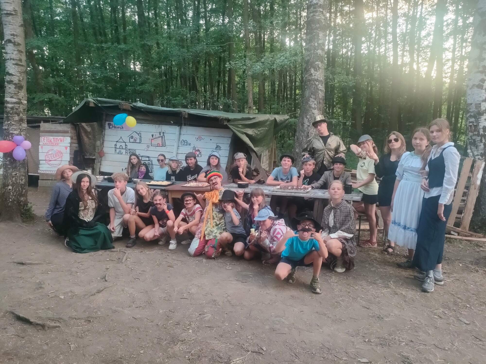
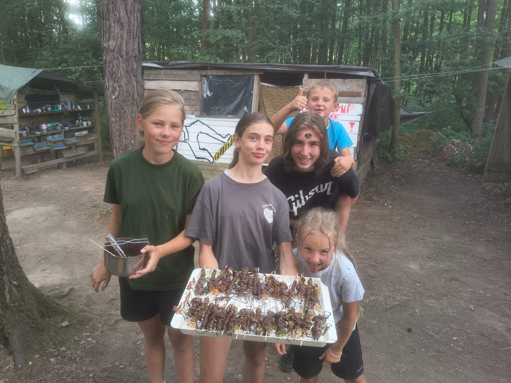

9.Den - Obrana města 🛡️🏙️

Po náročné noci jsme ráno po celém městečku nalezli velké množství výhružných vzkazů od Krvavých tváří. Tohle město už opravdu není bezpečné a vypadá to, že jejich dalším terčem je starosta. Proto jsme se rozhodli městečko přes den chránit. Identifikovali jsme velké množství zločinců a odpoledne jsme se rozhodli trochu odvést pozornost a odreagovat obyvatele olympiádou. Večer k nám dorazil starosta s tím, že mu někdo úplně rozházel kancelář. Šli jsme se tedy podívat na místo činu a objevili jsme mimo jiné i velmi důležité dokumenty. Starosta nám také oznámil, že se zítra koná banket, na který jsme všichni zvaní – především proto, abychom zastávali roli jeho ochranky.

10.Den - Přípravy na večerní banket 🥂

Vzhledem k tomu, že nás večer čekala důležitá společenská událost, museli jsme se na ni opravdu připravit. Přes den jsme získávali důležité informace a odpoledne bylo nutné přichystat občerstvení. Každá skupinka si vymyslela pokrm, který na banket připravila. Opravdu jsme se neměli za co stydět, protože jsme přinesli pizza tortillky, zapečené nachos s guacamole, chlebíčky s vajíčkovou pomazánkou a jako sladkou tečku na závěr ovocné špízy s čokoládou. Na večerním banketu jsme se potkali v podstatě se všemi podezřelými a měli jsme možnost si s nimi o všem promluvit. Bohužel se na banket dostal i člen Krvavých tváří, který zaútočil na Eleanor. Naštěstí jsme zasáhli a útočníka zneškodnili. Eleanor však utekla. Sledovali jsme ji a viděli, jak se střetla s cirkusákem Leonardem. Eleanor byla velmi rozrušená a upustila onu skříňku, kterou skrývala pod šátkem. Nevšimla si toho a odešla bez ní. Cirkusák si skříňku vzal a plánoval ji prodat. Než jsme však mohli zasáhnout, začal nám utíkat zatčený člen Krvavých tváří a zároveň jsme uslyšeli hádku starosty se Sarah. Nastal naprostý chaos. Rozhodli jsme se proto splnit náš hlavní úkol, kterým byla ochrana starosty. Naštěstí jsme situaci zdárně uklidnili, ale bohužel jsme ztratili jak podezřelého člena Krvavých tváří, tak samotnou skříňku. Musíme ji zítra najít!

 

