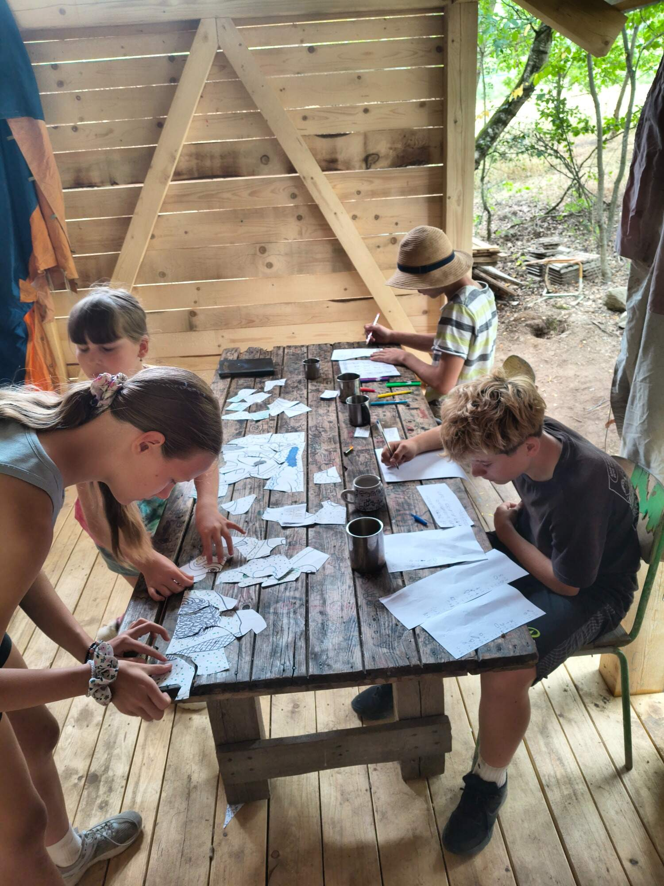
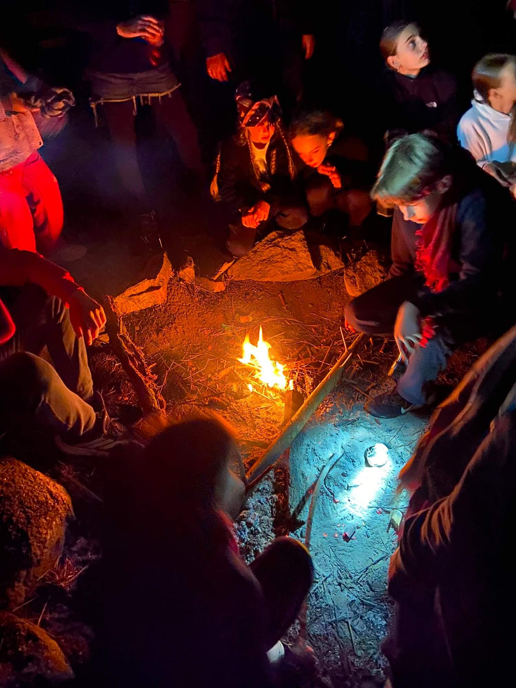
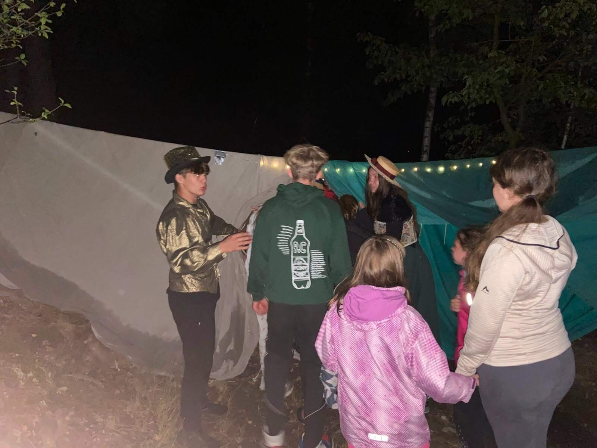

11.Den – Pátrání po cirkusákovi a skříňce 🎪🔎

Celý den jsme se snažili najít cirkusáka, protože je stále naším hlavním podezřelým a navíc má u sebe skříňku. Bohužel jsme zjistili, že ji již stihl prodat a že ji odkoupili lidé z továrny. Večer nám zavolal Viktor a informoval nás, že má podezření, že za vším stojí Sarah. Prý nám chce pomoci ji dopadnout, a proto nám zítra pošle na pomoc pracovníky z továrny, kteří nám poradí, jak se v jejích prostorách bezpečně pohybovat. Sarah totiž údajně plánuje zítra skříňku v továrně otevřít – a tomu musíme za každou cenu zabránit!

12.Den – Poznávání továrny 🏭⚙️

Ráno k nám dorazili čtyři pracovníci z továrny. Každý nám představil svou sekci a dal nám užitečné rady, na co si máme dát pozor. Večer nás pak čekala náročná cesta skrz továrnu za Sarah. Byla plná nejrůznějších nástrah, ale my jsme je všechny zdárně překonali. Na konci cesty na nás čekal Viktor, který nás zavedl přímo k Sarah. Ta byla obklopena členy Krvavých tváří a působila naprosto šíleně. V rukou držela skříňku a křičela, že nás všechny zničí. Následně zajala starostu, i cirkusáka. Nebýt Viktora, byl by s námi konec. Naštěstí v Sarah rozpoznal hrozbu a zlikvidoval ji. My jsme pak vzali skříňku a utíkali zpět na naši základnu, kde jsme celý její obsah spálili, aby již nikdy nemohl být proti nikomu použit. Svůj úkol jsme splnili a nyní nás čeká už jen oslava našich úspěchů! 🎉

 

 
